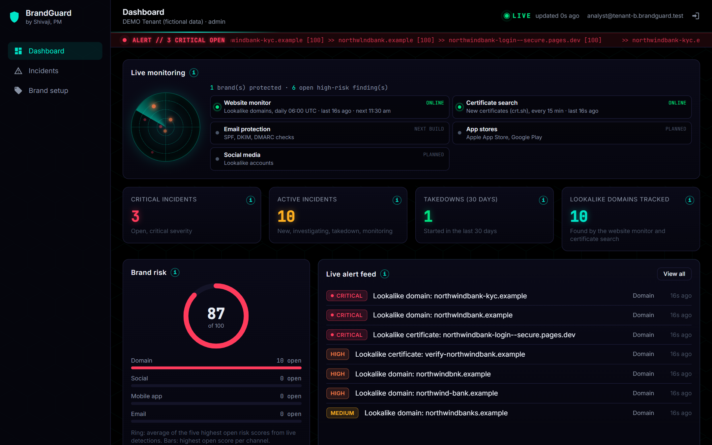
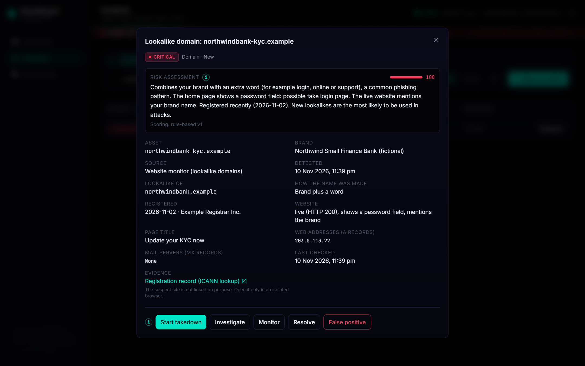
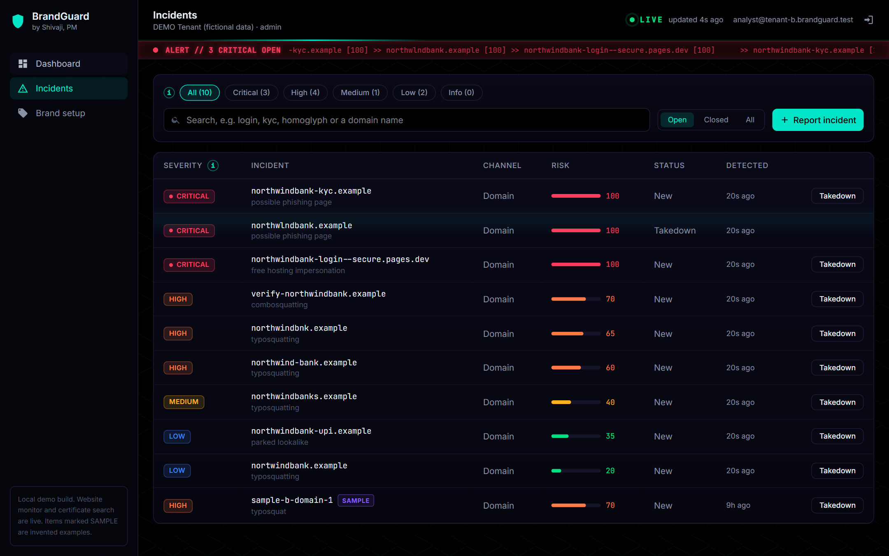
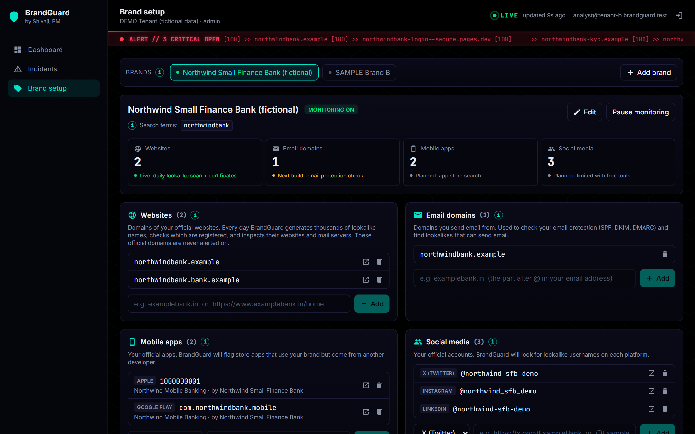
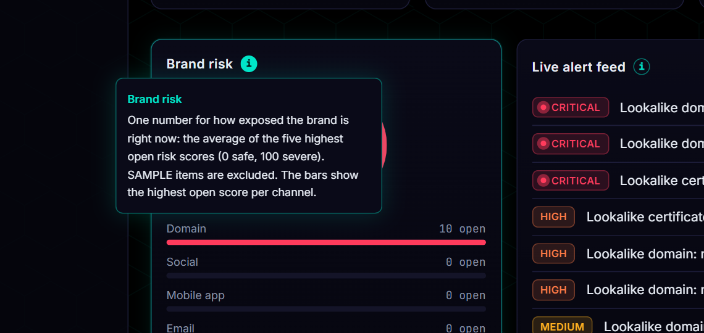
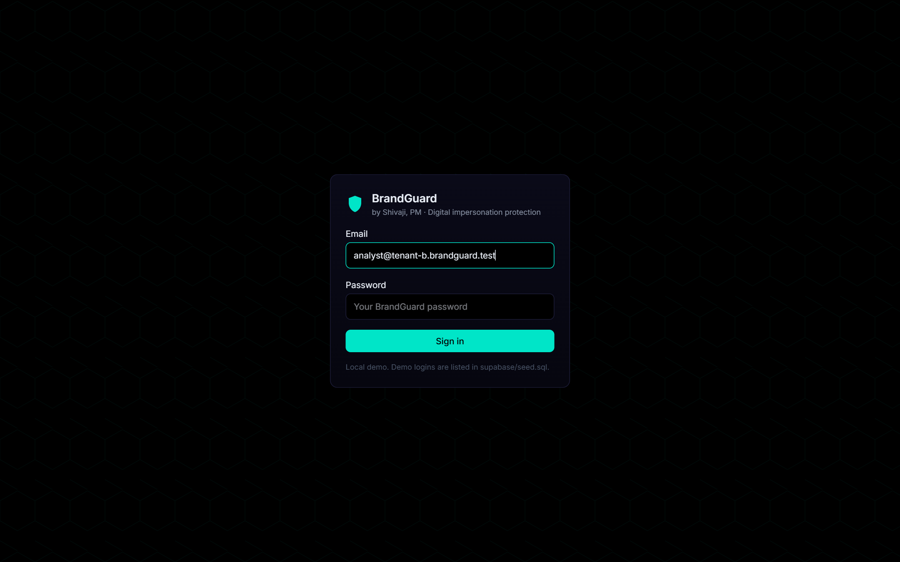
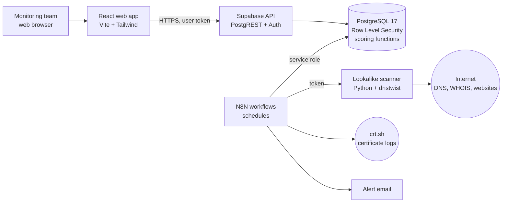

<div align="center">

# BrandGuard

**Digital brand impersonation protection for banks and regulated businesses**

*BrandGuard by Shivaji, PM*

[](https://github.com/Shivajibravo1/brandguard/actions/workflows/ci.yml)


</div>

---

Customers enter the websites, email domains, mobile apps and social media accounts they officially own. BrandGuard then searches the internet for lookalike and fake versions of those assets, scores each finding from 0 to 100 with a plain-English reason, alerts the security team, and tracks the response through to takedown.

> All screenshots and seed data use a **fictional** bank ("Northwind Small Finance Bank") with reserved `.example` domains. No real organisation is named or accused.



## Contents

- [Why BrandGuard](#why-brandguard)
- [Features](#features)
- [Screenshots](#screenshots)
- [Architecture](#architecture)
- [Technology stack](#technology-stack)
- [Security](#security)
- [Getting started](#getting-started)
- [Testing](#testing)
- [Repository structure](#repository-structure)
- [Roadmap](#roadmap)
- [How this project was built](#how-this-project-was-built)

## Why BrandGuard

Attackers impersonate a brand **outside** its network: a lookalike domain hosting a fake login page, a cloned app, a fake support account, or an email domain one letter away from the real one. Firewalls never see these. Banks are a prime target, because a single convincing "update your KYC (Know Your Customer) details" page can drain customer accounts.

BrandGuard watches for these fakes continuously and turns raw internet data into a short, prioritised list a monitoring team can act on.

## Features

| Area | What it does | Status |
|---|---|---|
| **Brand setup** | Customers register official websites, email domains, Apple App Store and Google Play apps, and social accounts (8 platforms). Pasted links are cleaned automatically; every input is validated in the browser and the database | Live |
| **Website monitor** | Generates thousands of lookalike names per domain (typos, look-alike characters, brand plus words such as `kyc` or `login`, about 20 domain endings), keeps the registered ones, then checks DNS (Domain Name System) records, WHOIS registration date and the live home page (parked, redirect, password field, brand mention) | Live, daily |
| **Certificate search** | Watches public Certificate Transparency logs (crt.sh) for new certificates containing the brand, including on free hosting platforms | Live, every 15 minutes |
| **Explainable scoring** | Rule-based 0 to 100 risk score with every reason written out, so analysts and auditors see *why* | Live |
| **Change detection** | Daily recheck updates evidence; an open finding whose risk rises 10 points or more (for example a parked domain that starts showing a login page) is alerted again | Live |
| **Alerting** | One digest email per run for findings scored 60 or more | Live |
| **Incident workflow** | Investigate, Takedown, Monitor, Resolve, False positive; takedown records; append-only audit log with the acting user | Live |
| **Multi-tenant** | Each customer (tenant) sees only its own data, enforced by PostgreSQL Row Level Security | Live |
| **Email protection** | SPF, DKIM and DMARC checks of the customer's own domains | Next |
| **App store and social monitors** | Store apps and accounts using the brand from someone else | Planned |
| **AI scoring** | Second-opinion score from a large language model, with OWASP LLM controls | Planned |

## Screenshots

| Dashboard | Incident detail |
|---|---|
|  |  |

| Incidents | Brand setup |
|---|---|
|  |  |

| In-app help on every section | Sign in |
|---|---|
|  |  |

## Architecture



Detection and scoring logic lives **in the database** (`ingest_lookalike_domains`, `score_lookalike_domain`, `ingest_ct_certificates`, `score_ct_candidate`), so it is covered by automated SQL tests. N8N only schedules, fetches and alerts.

A full High-Level Design (HLD) and Low-Level Design (LLD), including the data model, the scan sequence and a proposed Microsoft Azure production layout, is in [docs/ARCHITECTURE.md](docs/ARCHITECTURE.md).

## Technology stack

| Layer | Technology |
|---|---|
| Front end | React 19, Vite 8, Tailwind CSS 4 |
| Database, sign-in, API | Supabase (PostgreSQL 17, Supabase Auth, PostgREST) with Row Level Security |
| Automation | N8N 2.47 (self-hosted) |
| Lookalike engine | Python 3.12 service wrapping [dnstwist](https://github.com/elceef/dnstwist) (Apache 2.0) |
| Data sources | DNS, WHOIS, live home pages, crt.sh Certificate Transparency search |
| Runtime | Docker and Docker Compose; everything runs locally at zero cost |
| Quality | 37 SQL tests, oxlint, Bandit, npm audit, pip-audit, GitHub Actions CI |

## Security

Security was designed in, not added at the end. Highlights:

- **Tenant isolation** with Row Level Security on every table, tested for cross-tenant reads, writes and role escalation.
- **Least privilege:** visitors who are not signed in have no database access; signed-in users can never `TRUNCATE`; detection functions run only as the automation service.
- **Append-only audit log** and evidence that cannot be edited.
- **Scanner hardening:** shared-secret token, protection against Server-Side Request Forgery (SSRF) and DNS rebinding, read-only container with all Linux capabilities dropped, no package installer in the image.
- **Web hardening:** Content Security Policy, `X-Frame-Options: DENY`, no raw HTML rendering, suspect sites never rendered as clickable links.
- **Accounts:** no self sign-up, 12-character passwords with mixed case and digits, sign-in rate limits.

Controls are mapped to the **OWASP Top 10**, the **OWASP Top 10 for LLM applications** and **NIST CSF 2.0** in [docs/SECURITY.md](docs/SECURITY.md), together with the remaining risks. As with any software, an independent penetration test is required before production use.

## Getting started

**Requirements:** Docker Desktop, Node.js 22 or later, and Git.

```bash
git clone https://github.com/Shivajibravo1/brandguard.git
cd brandguard
cp .env.example .env
```

Fill in `.env`: the Supabase values come from `npx supabase@3.1.0 status -o env` after the first start, and `SCANNER_TOKEN` must be a long random value.

```bash
npx supabase@3.1.0 start                          # database, auth, API, mail inbox
docker compose -f docker-compose.n8n.yml up -d --build   # N8N and the scanner
npm --prefix web install
npm --prefix web run dev                          # http://localhost:5173
```

Demo logins (local only) are listed at the top of [supabase/seed.sql](supabase/seed.sql). The full walkthrough, including importing the N8N workflows and a 7-minute demo script, is in [docs/DEMO_GUIDE.md](docs/DEMO_GUIDE.md).

## Testing

```bash
bash supabase/tests/run_tests.sh
```

Runs every migration and **37 tests in 5 suites** in a throwaway PostgreSQL container:

| Suite | Covers |
|---|---|
| Tenant isolation (14) | Cross-tenant reads and writes, role escalation, audit log, tenant deletion |
| Certificate ingestion (6) | Scoring rules, brand-owned filtering, duplicates, failures |
| Brand assets (6) | Validation, clean-up, isolation, sync to known-good domains |
| Lookalike domains (6) | Indian endings such as `.bank.in`, scoring rules, re-scan and re-alert behaviour |
| Security hardening (5) | Least privilege for every role |

GitHub Actions runs the database tests, the web build and lint, and a Python security scan on every push.

## Repository structure

```
brandguard/
├── web/                     React front end (Dashboard, Incidents, Brand setup)
├── supabase/
│   ├── migrations/          SQL schema, Row Level Security, scoring (0001 to 0005)
│   ├── tests/               37 SQL tests and the test runner
│   ├── seed.sql             Fictional demo data (local only)
│   └── config.toml          Local Supabase settings
├── scanner/                 Lookalike domain scanner service (Python, dnstwist)
├── n8n/
│   ├── workflows/           Website monitor and certificate search workflows
│   └── credentials/         Local mail credential (no secrets)
├── docs/
│   ├── ARCHITECTURE.md      HLD, LLD, data model, sequences
│   ├── SECURITY.md          Controls mapped to OWASP and NIST
│   ├── DEMO_GUIDE.md        Run and demo the app
│   └── screenshots/
├── docker-compose.n8n.yml   N8N and scanner services
└── .github/workflows/ci.yml Continuous integration
```

## Roadmap

| Phase | Scope |
|---|---|
| Done | Multi-tenant core, certificate search, website monitor, explainable scoring, alerts, brand setup, security hardening |
| Next | Email protection checks (SPF, DKIM, DMARC) and lookalike mail servers |
| Then | App store monitor (Apple App Store, Google Play), social account monitor |
| Later | AI scoring with OWASP LLM controls, evidence packs and pre-filled abuse reports, regulator-ready reports, Microsoft Azure deployment |

## How this project was built

BrandGuard was conceived, specified and project-managed by **P. Shivaji, Project Manager**: product requirements, channel strategy, security requirements, governance checkpoints, testing and acceptance. Implementation was done with AI pair programming (Claude Code) under that direction, following a documented lifecycle with requirements, design, testing and security review at each stage.

## Disclaimer and license

This is a portfolio and demonstration project. Run scans only against brands you own or are authorised to monitor. A registered lookalike domain is not proof of wrongdoing; every finding needs human review.

Copyright (c) 2026 P. Shivaji. All rights reserved. The code is shared for review and portfolio purposes.
