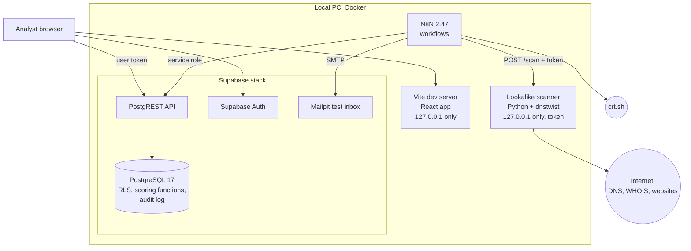
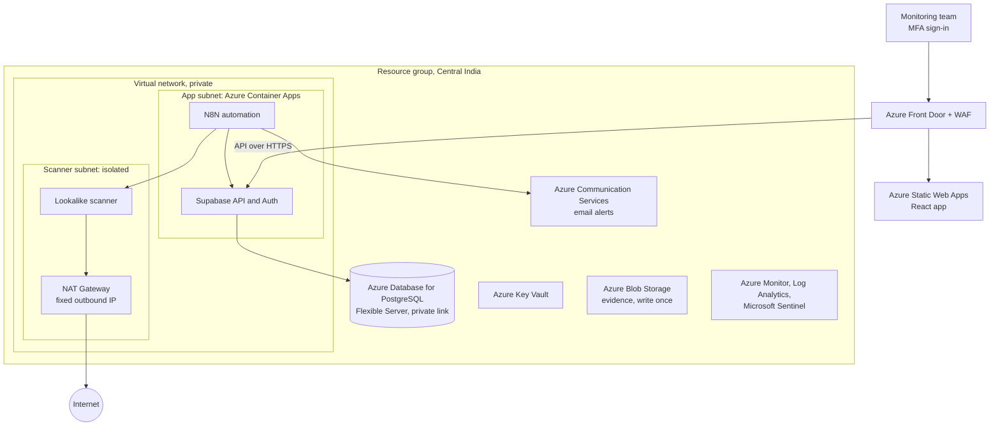
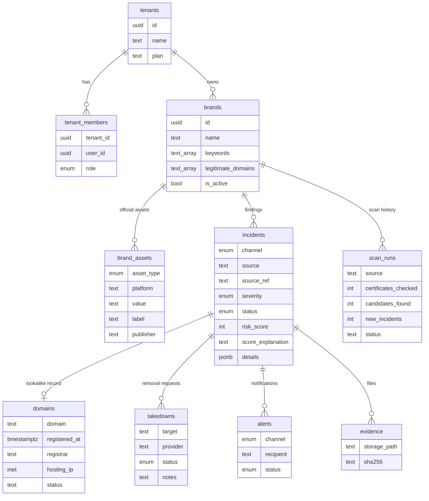
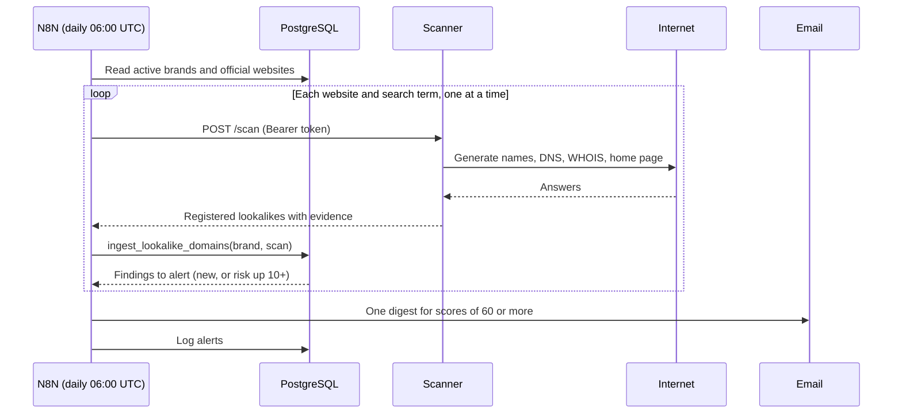

# BrandGuard architecture

BrandGuard by Shivaji, PM. This document describes the High-Level Design (HLD) and Low-Level Design (LLD) of the local build, and a proposed Microsoft Azure production layout.

## 1. Design principles

| Principle | How it shows up |
|---|---|
| Logic in the database, not the glue | Scoring and ingestion are PostgreSQL functions, covered by SQL tests. N8N only schedules, fetches and alerts. |
| Tenant isolation by default | Every business table carries `tenant_id`; Row Level Security (RLS) decides every read and write. |
| Explainable results | Every score lists the rules that applied, in plain English. |
| Least privilege | Browser users, the automation service and the scanner each get only what they need. |
| Zero cost locally | Everything runs in Docker on one PC with open-source components. |

## 2. High-Level Design (local build)

| Component | Port (this PC) | Role |
|---|---|---|
| Web app | 5173 | Dashboard, Incidents, Brand setup |
| Supabase API and Auth | 54321 | Data access and sign-in |
| PostgreSQL | 54322 | Data, RLS, scoring |
| Supabase Studio | 54323 | Database admin (local only) |
| Mailpit | 54324 (web), 54325 (SMTP) | Catches alert emails in the demo |
| N8N | 5678 | Workflow editor and scheduler |
| Scanner | 8090 | Lookalike generation and checks |

## 3. Proposed production layout (Microsoft Azure)

Not built yet. Service fit and pricing must be verified against current Azure documentation.

Key decisions: the database is reachable only on a private link, the scanner accepts no inbound traffic and leaves through one NAT (Network Address Translation) address, all secrets live in Key Vault, and an India region supports data residency for Indian banks (confirm per client).

## 4. Low-Level Design

### 4.1 Data model

`audit_log` (not drawn) records every insert, update and delete on business tables with the acting user. It has no foreign key on purpose, so history survives tenant deletion, and a trigger blocks any edit.

### 4.2 Website monitor sequence

### 4.3 Scoring rules (website monitor)

Starts at 25 points; the total is capped between 0 and 100.

| Signal | Points |
|---|---|
| Look-alike characters (homoglyph) | +20 |
| Brand plus a word (combosquatting) | +15 |
| One-character typo | +10 |
| Same name on another ending | +5 |
| Name under an unrelated domain | -10 |
| Home page shows a password field | +25 |
| Live site mentions the brand | +15 |
| Live site, nothing else known | +5 |
| Parked or for-sale page | -15 |
| Redirects to an official site | -45 |
| Has mail servers (MX) | +15 |
| No website and no mail server | -10 |
| Registered in the last 90 days / last year / over 5 years ago | +20 / +10 / -5 |

Severity: 80 to 100 critical, 60 to 79 high, 40 to 59 medium, 20 to 39 low, below 20 info.

### 4.4 Components

| Component | Location | Notes |
|---|---|---|
| Schema, RLS, roles, audit | `supabase/migrations/0001_initial_schema.sql` | Roles owner, admin, analyst, viewer |
| Certificate ingestion and scoring | `supabase/migrations/0002_ct_ingestion_and_scoring.sql` | Service role only |
| Brand assets | `supabase/migrations/0003_brand_assets.sql` | Clean-up trigger, format checks, sync to `legitimate_domains` |
| Lookalike ingestion and scoring | `supabase/migrations/0004_lookalike_domains.sql` | Indian endings such as `.bank.in`; re-alert on rising risk |
| Least-privilege hardening | `supabase/migrations/0005_security_hardening.sql` | Revokes unneeded table and function rights |
| Scanner service | `scanner/app.py` | dnstwist plus about 25 scam words and about 20 endings; SSRF and DNS-rebinding guard |
| Website monitor workflow | `n8n/workflows/lookalike_domain_watcher.json` | One target at a time; failures recorded |
| Certificate workflow | `n8n/workflows/crtsh_watcher.json` | Every 15 minutes |
| Web app | `web/src` | Polls every 20 seconds; info button on every section |

### 4.5 Error handling

| Failure | Behaviour |
|---|---|
| Scanner or crt.sh unreachable | `record_scan_failure` stores a failed scan run; the dashboard shows it in red; the next run retries |
| Same finding seen again | Unique key on (tenant, channel, source, asset) prevents duplicates; evidence and score are updated |
| Malformed scanner output | Rejected by the database function |
| Scanner request without token | HTTP 401, no work done |
